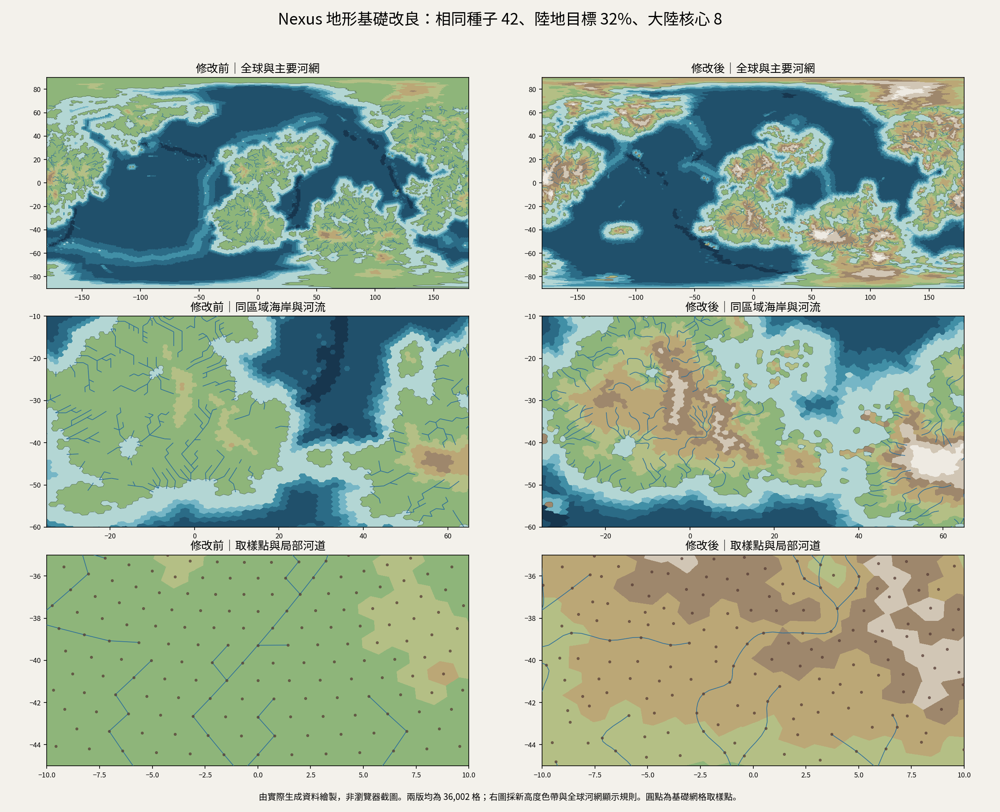

# 基礎網格、高度、海岸與河網改良

## 比較與判斷

參考本機 Azgaar 原始碼與 planet-simulation 提交 `d09634e7306c5859d0aafa4afe3a090b641e31bc`。本輪將演算法寫入 Nexus 自有核心，沒有新增對兩者執行環境的依賴。既有初始地形模板仍依賴 Azgaar 建置工具，尚未全部移除。

| 面向 | 參考程式提供的線索 | 原 Nexus 問題與本輪處理 |
| --- | --- | --- |
| 基礎網格 | Azgaar `grid-generator.ts` 使用擾動點與 Voronoi；planet 使用球面網格，水文另處理網格偏差 | 規則球面點容易讓河道沿固定方向排列。改為確定性球面切向擾動，重建 Delaunay、Voronoi、鄰接與面積；保留 36,002 個穩定 ID |
| 高度場 | planet 的地形與水文以浮點高度計算 | 原本 100 公尺整數量化，使低地與侵蝕結果形成大片同高格。正式高度改為 Float32、1 公尺步距，連同筆刷、Pack、快照及校驗更新 |
| 海岸 | Azgaar `coastline-generator.ts` 區分 feature outline、分形位移與閉合曲線，並讓填色共用形狀 | 由海陸邊界追蹤閉合球面迴圈，做一次角點細化；填色、岸線與河口共用幾何，處理換日線與極區。本輪沒有加入分形假海灣 |
| 平地排水 | planet `site/core/hydro.js` 的 priority flood 不以 epsilon 製造坡度，平地依出口距離路由 | 舊版洪水佇列訪問順序容易影響平地路由。改為 spill height、真實下坡與出口距離分工，驗證排水圖無環 |
| 河網辨識 | planet 的谷地支撐與短支流修剪；Azgaar 的流量、匯流與河道曲線 | 加入局部谷地支撐、面積門檻與短支流修剪；保留獨立沿海短河，計算 Strahler 階序；全球顯示主要河系，放大顯示支流 |
| 河道外形 | Azgaar `river-generator.ts` 的彎曲與 anchors；planet 的受約束曲線、共享匯流點與河口截斷 | 曲線通過原路由點，受地形走廊與高度限制；匯流點固定，海上尾段截於共用岸線；線寬依逐段每月流量繪製 |

## 同種子觀察

設定：種子 42、陸地目標 32%、大陸核心 8。修改前資料來自提交 `cd20231`；修改後使用本輪程式。基礎網格改變會改變生成結果，因此不是逐格相同地形的畫法比較。

| 指標 | 修改前 | 修改後 |
| --- | ---: | ---: |
| 基礎格數 | 36,002 | 36,002 |
| 陸地高度種類 | 60 | 2,950 |
| 相鄰陸格完全同高比例 | 24.16% | 0.27% |
| 保存河流數 | 733 | 1,070 |
| 全球視野顯示河流數 | 733 | 244 |

河流數增加不是品質分數：降低低解析度流域門檻後，保留更多支流；全球視野另外依階序、集水面積或長度篩選。高度種類增加也只表示量化損失減少，不等於已提高空間解析度。

此圖由實際生成資料以 Python 繪製，非瀏覽器截圖。右圖包含新高度色帶：200、500、1,000、2,000、4,000 公尺；左圖為原本每 1,700 公尺分色。因此顏色變化不能全部解讀為高度場變化。河線使用固定繪圖寬度展示幾何，正式 Canvas 則使用逐段每月流量。局部圖的圓點為基礎取樣點。圖表腳本：`scripts/render-terrain-comparison.py before.json after.json output.png`；量測摘要保存在 `terrain-foundation-metrics.json`。

## 實作邊界與下一階段

- 全球平均每格約 14,000 平方公里，仍無法表達公里尺度的小海灣與支流。1 公尺是垂直量化精度，不是地形誤差或水平解析度。
- 海岸仍以海陸格分類形成 Voronoi 邊界，角點細化改善一致性及折角，沒有從連續海拔場求零等高線。下一階段應將近岸細分網格與連續高度、海岸侵蝕／沉積一起處理。
- 高度底色仍是格面分色，局部放大可見多邊形；需要區域高解析度高度場及一致的插值／編輯規則才能消除這項限制。
- 河流曲線是受地形約束的顯示幾何；沒有宣稱已模擬沖積平原上的河道遷移、三角洲分流或完整河流動力。
- 本輪不保留舊網格格式。地形快照版本為 2，拒絕舊格式；沒有舊地圖遷移支線。
- 現有地圖編輯的「高度已改、環境尚未重算」工作流程仍適用；手動重算後才更新水文與氣候。

## 驗證

新測試 `experiments/spherical-grid/terrain-foundation.test.mjs` 檢查球面閉合、面積、鄰接變化、1 公尺儲存及校驗、平地出口路由、重新編號穩定性、兩種極區／接縫海陸分類、河口交點與匯流 anchors。介面測試檢查共用岸線裁切與河網放大顯示規則。正式 Worker 測試覆蓋生成、筆刷、手動重算、JSON 儲存重開與無效資料拒絕。

數值、拓樸與操作測試不能證明美觀已超過 Azgaar 或 planet；本輪對照可確認規則折線減少、低地高度不再大量截斷，以及岸線與河口使用同一幾何。仍需更多種子與區域細分設計來提升自然度。

Pack 密度重建另檢查支流第一次接觸母河的位置，避免投影連接步驟沿母河倒走。周邊自動排水若因固定河道形成循環，僅重新連接尚未通往出口的集水區；固定河道本身的循環仍拒絕。此檢查包含原有正式 Worker 的密度切換回歸。

本輪驗證通過：地形 30、地質 24、氣候 24、推演與通訊 9、水文／生態 10、基礎地形 8、高度與正式 Worker 15、介面 10、地圖回歸 54、快照 2，共 186 項。修正 Pack 投影循環後，已重跑水文、基礎地形、正式 Worker、介面與地圖回歸。`npm run build` 通過（含 TypeScript）；相關修改模組 ESLint 通過。視覺對照採資料繪圖，未宣稱完成瀏覽器實機視覺驗證。
